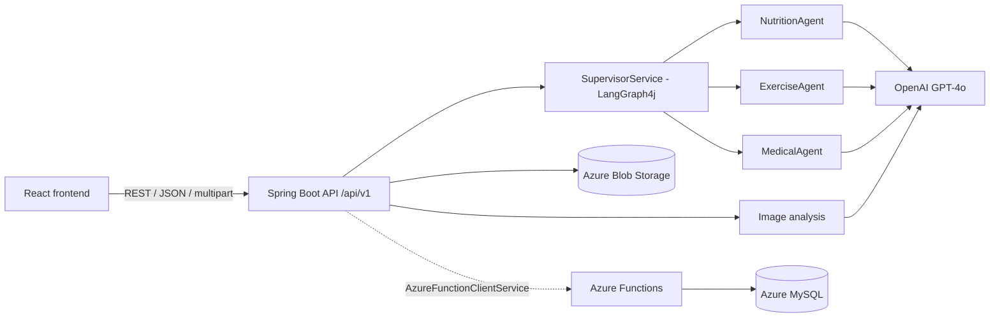

# HealthIA

> A bilingual multi-agent wellness assistant for nutrition, activity, and everyday health guidance — built with Java, Azure, OpenAI, and LangGraph.

<p align="center">
  <a href="https://healthia-ai.vercel.app"></a>
  <a href="./frontend"></a>
  <a href="./backend"></a>
  <a href="./backend/azure-functions"></a>
</p>

<p align="center">
  
</p>

HealthIA combines a React experience with a Java Spring Boot API and Azure Functions to deliver conversational coaching, meal-photo analysis, personalized meal plans, exercise guidance, and health-profile context. Modular AI agents, orchestrated with LangGraph, route each request to the right specialist. The interface supports English and Spanish and is designed around a mobile-first wellness journey.

> **Prototype notice:** HealthIA is an educational/product prototype, not a medical device or a substitute for professional medical advice. AI output must be reviewed by a qualified professional before any health decision.

## Project snapshot

| Surface | Status |
| --- | --- |
| **Live UI** | [Open HealthIA](https://healthia-ai.vercel.app) |
| **Frontend** | React 19 + React Router + Create React App, deployed on Vercel. |
| **Backend** | Java 17 + Spring Boot 3 API (`/api/v1`) with LangGraph4j agents, intended to run locally or on a separately managed HTTPS host (e.g. Azure App Service). |
| **Serverless** | Azure Functions for nutrition, exercise, medical, image-analysis, smartwatch, and dashboard metrics. |
| **AI boundary** | OpenAI (GPT-4o / GPT-4o-mini) chat and vision, configured through environment variables. |
| **Data boundary** | Azure Blob Storage for media and Azure MySQL for function data. |

The deployed UI is intentionally usable as a showcase. Chat and image-analysis actions require a separately hosted backend configured through `REACT_APP_API_URL`; no public backend is implied by the Vercel preview.

## The problem

- 🩺 **Chronic disease epidemic** — obesity, diabetes, and hypertension driven by poor daily routines.
- 🚪 **Low engagement with health apps** — most users quit within 30 days due to lack of relevance and feedback.
- 📊 **Fragmented health data** — wearables and food logs are siloed and rarely used for real-time personalized feedback.

## What HealthIA does

- 💬 **Health chatbot** — ask "I work remotely and feel back pain" and get personalized suggestions, activity reminders, and stretching or hydration plans (text, image, and audio input).
- 📸 **Meal scanner** — snap a plate; OpenAI vision compares it with the Harvard Healthy Eating Plate and returns feedback such as "add more greens".
- 🥗 **Diet generator** — context-aware recipes with macros, video tutorials, and shareable meal plans that adapt to conditions and goals.
- 🏋️ **Workout planner** — weekly routines adjusted with sleep, steps, and heart-rate data.
- 🩺 **Medical personalization** — allergies and chronic conditions restrict or enhance every recommendation.
- ⌚ **Wearable integration** — smartwatch metrics feed the dashboard and the agents.

## Screens

<p align="center">
  
  
  
</p>

<p align="center">
  
</p>

## Architecture



- 🤖 **LangGraph-based multi-agent flow** — a central `SupervisorService` classifies each request and delegates to `NutritionAgent`, `ExerciseAgent`, or `MedicalAgent`.
- ☁️ **Azure + OpenAI** — Spring Boot API plus Azure Functions, Blob Storage, and MySQL, powered by GPT-4o.
- ⌚ **IoT integration** — the smartwatch function syncs wearable data for adaptive suggestions.
- 📡 **REST API with Spring Boot** — modular endpoints under `/api/v1`.

### Why Java?

- ⚡ **Spring Boot productivity** — rapid API development, scheduling, and microservice capabilities.
- 🧠 **Supervisor-agent orchestration** — modular request classification and delegation.
- 🔗 **Native cloud + AI integrations** — connects cleanly to OpenAI, Azure Functions, and storage services.
- ✅ **Strongly-typed ecosystem** — static typing for better code quality and debugging.

### Azure system design


The target cloud design uses Azure API Management, Azure Functions, Azure Blob Storage, Azure OpenAI, Azure MySQL, and Azure Front Door + WAF.

### Agentic framework

<p align="center">
  
</p>

<details>
<summary><strong>Sequence diagrams</strong></summary>

**1. Meal scanner + AI feedback**


**2. Health chatbot interaction**


**3. Workout routine generator**


</details>

### API surface

All routes are served under `/api/v1`.

| Method | Route | Purpose |
| --- | --- | --- |
| `PUT` | `/chatbot` | Text, image, or audio conversation input. |
| `GET` | `/show-chats` | List persisted conversations. |
| `DELETE` | `/delete-chat/{chat_id}` | Remove a conversation. |
| `PUT` | `/analyze-image` | Analyze a meal image. |
| `GET` | `/list-analyses` | List image-analysis history. |
| `GET` | `/show-analysis/{analysis_id}` | Show one image analysis. |
| `DELETE` | `/delete-analysis` | Remove an image analysis. |

## Repository layout

```text
.
├── frontend/                  # React application and product UI
├── backend/                   # Maven multi-module Java backend
│   ├── src/main/java/...      # Spring Boot API, controllers, services, LangGraph agents
│   ├── healthia-app/          # Azure Function client and DTOs
│   └── azure-functions/       # Nutrition, exercise, medical, image, smartwatch, dashboard functions
└── .github/workflows/ci.yml   # Frontend build check
```

See [`backend/README.md`](./backend/README.md) for a detailed walkthrough of the Java modules and Azure deployment.

## Run locally

### 1. Start the API

```bash
cd backend
# Set OPENAI_API_KEY and AZURE_STORAGE_CONNECTION_STRING in your environment first
./mvnw spring-boot:run   # Windows: mvnw.cmd spring-boot:run
```

The API listens on `http://localhost:8080` (override with `PORT`). Azure Functions run separately with `mvn azure-functions:run` inside each function folder; copy values into each `local.settings.json` locally and never commit real keys.

### 2. Start the frontend

```bash
cd frontend
npm ci
copy .env.example .env.local  # PowerShell; use cp on macOS/Linux
npm start
```

The frontend runs at [http://localhost:3000](http://localhost:3000). The local `.env.local` should point to `http://localhost:8080/api/v1`.

### 3. Build for production

```bash
cd frontend
npm run build
```

For Vercel, import the repository with **Root Directory** set to `frontend`, keep the Create React App preset, and add `REACT_APP_API_URL` only when a public HTTPS backend is available.

## Environment variables

Frontend (`frontend/.env.example`):

```env
REACT_APP_API_URL=http://localhost:8080/api/v1
```

Backend (environment, read by `application.properties`):

```env
OPENAI_API_KEY=replace-me
OPENAI_MODEL=gpt-4o-mini
AZURE_STORAGE_CONNECTION_STRING=replace-me
AZURE_STORAGE_CONTAINER_NAME=healthia
PORT=8080
```

Never commit `.env` files, API keys, credentials, or uploaded user data.

## Team

<p align="center">
  <a href="https://www.linkedin.com/in/fransua-leon/"></a>
  <a href="https://www.linkedin.com/in/sergioyupanquigomez/"></a>
  <a href="https://www.linkedin.com/in/luisangelorp/"></a>
</p>

<details>
<summary><strong>Azure deployment snapshots</strong></summary>

<p align="center">
  
  <br/>
  
</p>

</details>

## License

No license file is currently included. Add a license before accepting external contributions or redistributing the code.
